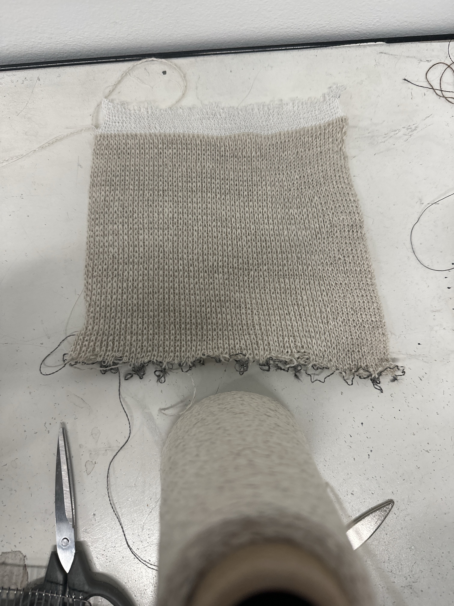

# Conductive knit swatches

A bench log for machine-knit swatches. One entry per swatch: what was set on the machine, what happened, and what was measured afterwards.

Each entry keeps Rose's notes as written, then a reading of them. The reading is an interpretation; where it guesses, it says so.

**Why log settings at all:** a conductive knit is a resistor whose value depends on how the loops touch each other. Yarn, gauge, tension, stitch count and row count all change that contact, so a resistance reading means nothing later unless the settings that produced it are next to it.

## Swatch 1: cream, all knit (2026-11-11)

Notes as written:

> 8 gauge tension 13
> 60 stitches width 80 rows
> Cream-all knit
> Felt tight changed to tension 14 after 2 row
> Changed tension to 15 after 18

| Setting | Value |
|---|---|
| Machine gauge | 8 |
| Yarn | Cream (the cone in the photo) |
| Structure | All knit (plain) |
| Width | 60 stitches |
| Length | 80 rows |
| Tension | 13 for rows 1–2, 14 for rows 3–18, 15 from row 19 to the end |

- The fabric felt tight at tension 13, so it was loosened twice.
- Consequence: the swatch has three tension zones. Only the rows from 19 on (about 62 of the 80) are at one setting, so measure stitch size and resistance there, not across the whole length.
- The photo shows white rows at one edge and dark thread at the other. Assumed to be waste yarn and the cast-on thread; not confirmed.
- This swatch is assumed to be the non-conductive baseline (plain cream yarn only); not confirmed.

Not yet recorded: yarn name and fibre, finished size in cm, stitches and rows per 10 cm in the tension-15 zone.

## Swatch 2: JLFiber 275 (2026-11-11, restarted)

Notes as written:

> Onto JLFiber 275* 2 swatch and thread broke start cast on again.

- The thread broke, and the cast-on was started again. No finished swatch yet.
- Not recorded: which thread broke (the JLFiber or a carrier yarn), at which row, and at which tension.
- "275* 2" is unclear: it may mean two ends of JLFiber 275 knit together, or it may mean "275, second swatch". To confirm.

## To measure on each finished swatch

| Measurement | Why |
|---|---|
| Finished width and length (cm), relaxed | Converts stitch counts into real size |
| Resistance end to end along the rows, relaxed | The baseline value |
| Resistance end to end along the columns, relaxed | Knit is not the same in both directions |
| The same two readings while stretched by a known amount | Shows whether the swatch can act as a stretch sensor, and in which direction |
| The same readings while pressed | Shows whether it can act as a pressure sensor |
